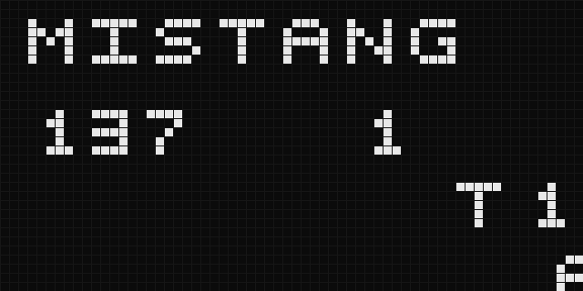

# mistang-core-chip8

CHIP-8 core for MiSTang (Sipeed Tang Nano 20K). Written from scratch.

- `rtl/chip8_cpu.sv`: the CPU (all 35 opcodes, 4 KiB RAM, 64x32 framebuffer, sprite clipping, 60 Hz timers).
- `tools/ref8.py`: a separate reference interpreter used to check the RTL.
- `tools/mktest.py`: builds the self-test ROM (title, BCD, carry, collision, clipping).
- `test.sh`: runs the RTL in iverilog, compares the whole frame with the reference, renders the screenshot.

## Board build

`rtl/top/chip8_top.sv`: 720p60 HDMI (64x32 at 16x), CPU on the 27 MHz clock, UART screenshot stream
(`CH8F` + 256 bytes + 2 bytes state, 115200 baud, `tools/capture.py`). `build.sh` produces `build/chip8_top/chip8_top.fs`.
Timing passes (clk_p 82 MHz at 74.25, CPU 39 MHz at 27). The UART stream is checked in simulation (`sim/tb_top.sv`).

Status: CPU verified in simulation against the reference. On the board the design loads and the heartbeat LED runs,
but a board screenshot is not captured yet: the USB-UART bridge currently returns no data, even for a plain square wave on the pin.
